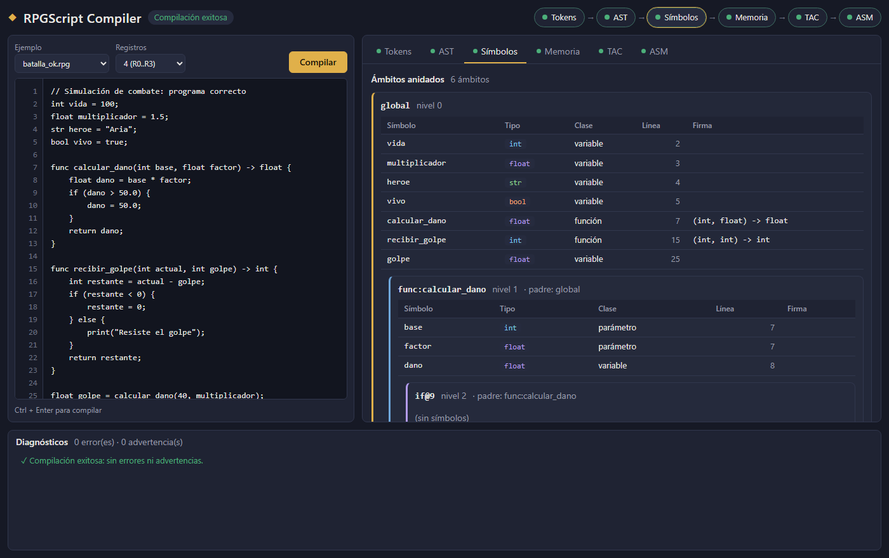
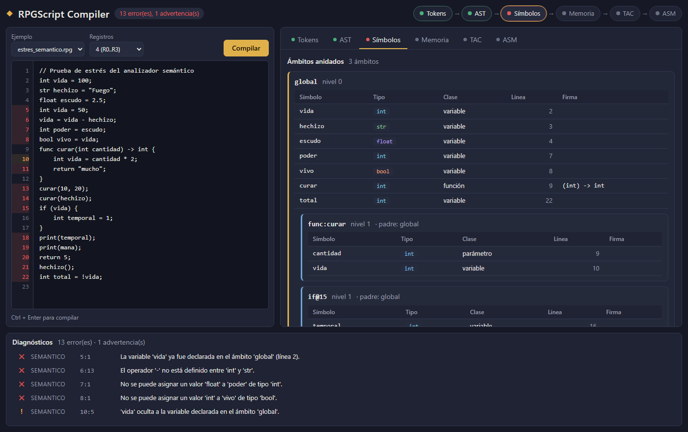
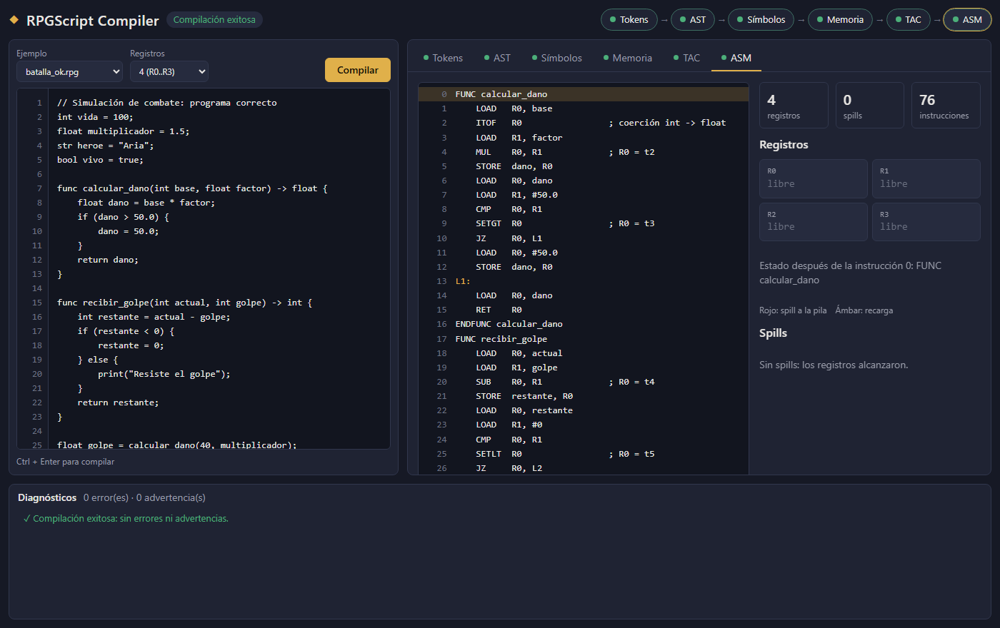

# RPGScript: mini-compilador con analizador semántico y gestor de ámbitos

Proyecto final de **Compiladores**, Universidad Cooperativa de Colombia (docente Mg. Gabriel Guerrero Arellano).
Integrantes: **Juan Camilo**, **Rafael** y **Saray**.

RPGScript es un lenguaje pequeño con temática de juego de rol (vida, daño, hechizos, escudos) y su compilador, escrito en
**Python 3.10+ sin librerías externas**. El compilador recibe un archivo `.rpg` y lo transforma paso a paso por todas las
fases vistas en el curso:

```
Código fuente → Tokens → AST → Tabla de símbolos y tipos → Memoria → TAC (cuádruplas) → Pseudo-ensamblador
```

El **núcleo del proyecto es el análisis semántico**: una tabla de símbolos con ámbitos anidados en pila
(global → función → bloque `if`) y un chequeador de tipos con inferencia y coerción. Es el árbitro que impide, por ejemplo,
restar un texto a los puntos de vida, usar una variable fuera del bloque donde nació o llamar a una función con argumentos
equivocados. Todos los errores se reportan con **línea y columna exactas**, sin que el compilador se detenga.



## Contenido

1. [Inicio rápido](#1-inicio-rápido)
2. [El lenguaje RPGScript](#2-el-lenguaje-rpgscript)
3. [Fases del compilador y fundamentos teóricos](#3-fases-del-compilador-y-fundamentos-teóricos)
4. [Resultados y casos de prueba](#4-resultados-y-casos-de-prueba)
5. [Vista web](#5-vista-web)
6. [Arquitectura](#6-arquitectura)
7. [Pruebas](#7-pruebas)
8. [Seguridad](#8-seguridad)
9. [Equipo y flujo de trabajo](#9-equipo-y-flujo-de-trabajo)

## 1. Inicio rápido

Requisito: Python 3.10 o superior. No hay que instalar nada más.

```bash
git clone https://github.com/Juan-Camilo-Martinez-B/proyecto_final_compiladores.git
cd proyecto_final_compiladores/backend
```

**Vista web** (servidor y frontend juntos):

```bash
python server.py
# abrir http://127.0.0.1:8000
```

**Consola**, todas las fases o una sola:

```bash
python main.py examples/batalla_ok.rpg
python main.py examples/batalla_ok.rpg --phase symbols     # tokens | ast | symbols | memory | ir | asm | all
python main.py examples/spill_registros.rpg --registers 2  # CPU simulada con 2 registros
python main.py examples/estres_semantico.rpg --json        # respuesta completa en JSON
```

**Pruebas**:

```bash
python -m unittest discover -s tests -v
```

## 2. El lenguaje RPGScript

```
// Simulación de combate
int vida = 100;
float multiplicador = 1.5;
str heroe = "Aria";

func calcular_dano(int base, float factor) -> float {
    float dano = base * factor;      // int * float: coerción implícita a float
    if (dano > 50.0) {
        dano = 50.0;
    }
    return dano;
}

float golpe = calcular_dano(40, multiplicador);
print(heroe + " sigue en pie");
```

| Elemento | Detalle |
|----------|---------|
| Tipos | `int`, `float`, `str`, `bool`; `void` solo como tipo de retorno |
| Sentencias | declaración, asignación, `if` con `else` opcional, bloques, `func ... -> tipo`, `return`, `print(expr)` |
| Operadores | `+ - * /`, `== != < > <= >=`, `&& \|\| !`, `-` unario |
| Comentarios | `// hasta el final de la línea` |
| Fuera de alcance | ciclos, arreglos, clases, funciones anidadas |

### Gramática (EBNF)

```
program      → declaration* EOF
declaration  → funcDecl | statement
funcDecl     → "func" IDENTIFIER "(" params? ")" "->" TYPE block
statement    → varDecl | assignment | ifStmt | returnStmt | printStmt | exprStmt | block
varDecl      → TYPE IDENTIFIER ( "=" expression )? ";"
assignment   → IDENTIFIER "=" expression ";"
ifStmt       → "if" "(" expression ")" block ( "else" block )?
returnStmt   → "return" expression? ";"
printStmt    → "print" "(" expression ")" ";"
block        → "{" statement* "}"

expression   → logicOr
logicOr      → logicAnd ( "||" logicAnd )*
logicAnd     → equality ( "&&" equality )*
equality     → comparison ( ( "==" | "!=" ) comparison )*
comparison   → term ( ( "<" | ">" | "<=" | ">=" ) term )*
term         → factor ( ( "+" | "-" ) factor )*
factor       → unary ( ( "*" | "/" ) unary )*
unary        → ( "-" | "!" ) unary | call
call         → IDENTIFIER "(" arguments? ")" | primary
primary      → INT | FLOAT | STRING | "true" | "false" | IDENTIFIER | "(" expression ")"
```

### Sistema de tipos

| Operador | Operandos permitidos | Resultado |
|----------|----------------------|-----------|
| `+` | numéricos en cualquier mezcla, o `str + str` | `int` si ambos son int, `float` si alguno es float, `str` al concatenar |
| `-` `*` `/` | numéricos en cualquier mezcla | `int` si ambos son int (división entera); si no, `float` |
| `<` `>` `<=` `>=` | numéricos | `bool` |
| `==` `!=` | mismo tipo, o mezcla numérica | `bool` |
| `&&` `\|\|` | `bool`, `bool` | `bool` |
| Asignación, argumento, `return` | tipos iguales, **o** destino `float` y origen `int` | `float → int` es error (pérdida de precisión) |

## 3. Fases del compilador y fundamentos teóricos

Cada fase es un módulo de `backend/rpg_compiler/` y corresponde a una sesión del curso. La documentación detallada de
cada una está en `docs/`.

| Fase | Módulo | Concepto teórico | Cómo se materializa | Sesión |
|------|--------|------------------|---------------------|--------|
| Léxico | `lexer.py` | Lexema, token y patrón; expresiones regulares equivalentes a autómatas finitos (DFA) | Una sola expresión regular con grupos nombrados; cada token guarda línea y columna; los errores no detienen el escaneo | 1 y 2 |
| Sintáctico | `parser.py` | Gramáticas libres de contexto, precedencia y asociatividad, parseo descendente, AST | Parser descendente recursivo (un método por regla); recuperación por inserción de símbolos y modo pánico | 3 y 4 |
| Tabla de símbolos | `symbol_table.py` | Ámbitos anidados, pila de ámbitos, visibilidad unidireccional, `lookup` | Pila de `Scope` con enlace al padre; `lookup` sube de lo local a lo global; traza de cada operación | 5 |
| Tipos | `type_system.py`, `semantic_analyzer.py` | Inferencia, equivalencia, compatibilidad, coerción y errores semánticos | Tabla de reglas `(op, izq, der) → tipo` en un diccionario; 17 reglas semánticas; tipo `error` que evita cascadas | 6 |
| Memoria | `memory_model.py` | Stack frente a heap, registros de activación, desplazamientos | Segmento global, un frame por función con dirección de retorno y FP, cadenas en el heap | 8 y 9 |
| IR | `ir_generator.py` | Representación intermedia (M + N), código de tres direcciones, cuádruplas | Cuádruplas `(op, arg1, arg2, result)` con temporales, etiquetas y coerciones `int_to_float` explícitas | 7 |
| Código objetivo | `codegen.py` | Selección de instrucciones, asignación de registros, *spill* | Pseudo-ensamblador con un banco limitado de registros; *spill* LRU a la pila y recarga | 10 |

Documentación por módulo:

- [docs/lexer_parser.md](docs/lexer_parser.md): análisis léxico y sintáctico, CLI y servidor.
- [docs/semantic.md](docs/semantic.md): tabla de símbolos, sistema de tipos, reglas S01 a S17 y modelo de memoria.
- [docs/ir_codegen.md](docs/ir_codegen.md): código de tres direcciones y generación de código.
- [docs/frontend.md](docs/frontend.md): vista web.
- [docs/PLAN_DE_TRABAJO.docx](docs/PLAN_DE_TRABAJO.docx): plan completo del proyecto y división del trabajo.

### Política de errores

Cada fase reúne **todos** sus errores y luego decide si la siguiente puede ejecutarse. El compilador nunca se cae: una
excepción inesperada se convierte en un diagnóstico.

| Si hay errores en... | Qué se reporta | Fases que se muestran |
|----------------------|----------------|-----------------------|
| Léxico | todos los errores léxicos | Tokens |
| Sintáctico | todos los errores sintácticos | Tokens y AST parcial |
| Semántico | todos los errores y advertencias semánticos | Tokens, AST, tabla de símbolos y traza |
| Ninguno (solo advertencias) | las advertencias | Todas las fases |

```
[SEMANTICO] error en línea 6, columna 13: El operador '-' no está definido entre 'int' y 'str'.
[SEMANTICO] warning en línea 10, columna 5: 'vida' oculta a la variable declarada en el ámbito 'global'.
```

## 4. Resultados y casos de prueba

Los programas de `backend/examples/` son los casos de la sustentación. Sus resultados están verificados por
`tests/test_pipeline.py`.

| Programa | Qué demuestra | Resultado |
|----------|---------------|-----------|
| `batalla_ok.rpg` | Flujo correcto completo | Las 6 fases sin errores; coerción `int_to_float` en el TAC; 0 spills |
| `error_lexico.rpg` | Errores léxicos | 3 errores: `@` (línea 2), cadena sin cerrar (línea 3), `2poder` (línea 4) |
| `error_sintactico.rpg` | Recuperación sintáctica | 3 errores (líneas 1, 2 y 5), sin errores en cascada |
| `estres_semantico.rpg` | Prueba de estrés del semántico | 13 errores y 1 advertencia, uno por cada regla violada |
| `spill_registros.rpg` | Presión sobre los registros | 2 spills con 4 registros y 4 spills con 2 registros |



### Trazabilidad con el checklist del docente

| Criterio | Cómo se cumple |
|----------|----------------|
| 1. Pipeline continuo Tokens → AST → TAC → Ensamblador | `pipeline.compile_source()` ejecuta las 6 fases; la CLI y la web las muestran paso a paso |
| 2. Manejo riguroso de errores con línea exacta, sin detenerse | `ErrorReporter` acumula diagnósticos con fase, línea y columna; recuperación de errores en cada fase |
| 3. Gestión de recursos de hardware | Tabla de símbolos con traza de la pila, modelo de memoria (frames, global y heap) y asignación de registros con spill |
| 4. Defensa de casos de prueba | `batalla_ok.rpg` (flujo correcto) y `estres_semantico.rpg` (estrés semántico), más los casos de error y de spill |

## 5. Vista web

HTML, CSS y JavaScript con módulos ES, sin frameworks. La sirve el mismo `server.py`.

- **Editor** con números de línea, ejemplos precargados, selector de registros y botón *Compilar* (`Ctrl + Enter`).
  Las líneas con errores se marcan en rojo y las advertencias en ámbar.
- **Barra de pipeline**: cada fase en verde (ok), rojo (error) o gris (omitida).
- **Pestañas por fase**: tokens con filtro, AST colapsable con el tipo inferido de cada expresión, ámbitos anidados con su
  tabla de símbolos y una traza que se puede reproducir paso a paso, memoria como pila de frames, cuádruplas y
  ensamblador con el estado de los registros en cada instrucción.
- **Diagnósticos**: un clic lleva a la línea del error en el editor.



## 6. Arquitectura

```
proyecto_final_compiladores/
├── backend/
│   ├── main.py                 CLI
│   ├── server.py               servidor HTTP (biblioteca estándar)
│   ├── rpg_compiler/
│   │   ├── tokens.py           contrato: tipos de token
│   │   ├── errors.py           contrato: diagnósticos y ErrorReporter
│   │   ├── ast_nodes.py        contrato: nodos del AST y NodeVisitor
│   │   ├── pipeline.py         orquestador de las fases
│   │   ├── lexer.py            fase 1
│   │   ├── parser.py           fase 2
│   │   ├── symbol_table.py     fase 3
│   │   ├── type_system.py      fase 3
│   │   ├── semantic_analyzer.py fase 3
│   │   ├── memory_model.py     fase 4
│   │   ├── ir_generator.py     fase 5
│   │   └── codegen.py          fase 6
│   ├── examples/               programas .rpg de la sustentación
│   └── tests/                  pruebas unitarias y de integración
├── frontend/                   vista web
└── docs/                       documentación, contrato de la API y plan
```

Decisiones de diseño:

- **Patrón Visitor** (`NodeVisitor`): el análisis semántico y la generación de IR recorren el mismo AST sin modificar
  sus nodos.
- **Nodos del AST como `dataclass(kw_only=True)`**: constructores explícitos y serialización automática a JSON.
- **Reglas de tipos en diccionarios** indexados por tuplas: búsqueda O(1) y fáciles de mostrar.
- **`ErrorReporter` compartido**: todas las fases reportan sin detenerse.
- **Pipeline tolerante a fallos**: cada fase se ejecuta aislada; una falla se convierte en diagnóstico.
- **Un único contrato JSON** ([docs/contract/api_response_example.json](docs/contract/api_response_example.json)):
  la CLI y la web consumen exactamente la misma respuesta.

API del servidor:

| Ruta | Descripción |
|------|-------------|
| `POST /api/compile` | Cuerpo `{"source": "...", "register_count": 4}`; responde `success`, `status`, `diagnostics` y `phases` |
| `GET /api/examples` | Programas de `backend/examples` con su contenido |
| `GET /...` | Archivos de `frontend/` |

## 7. Pruebas

```bash
cd backend
python -m unittest discover -s tests -v
```

128 pruebas, todas con la biblioteca estándar (`unittest`):

| Archivo | Cubre |
|---------|-------|
| `test_lexer.py`, `test_parser.py` | Tokens, posiciones, precedencia, sentencias y recuperación de errores |
| `test_symbol_table.py`, `test_type_checker.py`, `test_memory_model.py` | Visibilidad de ámbitos, reglas S01 a S17, coerción y diseño de memoria |
| `test_ir_generator.py`, `test_codegen.py` | Cuádruplas, etiquetas, coerciones, selección de instrucciones y spill |
| `test_cli.py`, `test_server.py` | Salida de la CLI y validaciones de la API |
| `test_pipeline.py` | Integración de punta a punta: los 5 programas de la sustentación, entradas inusuales y mocks de la web |

## 8. Seguridad

- El servidor escucha solo en `127.0.0.1` y limita cada petición a 64 KB.
- Se valida el JSON de entrada (`source` debe ser texto y `register_count` un entero entre 2 y 16).
- Los archivos estáticos solo se sirven desde `frontend/`, con protección contra *path traversal*.
- El código del usuario **nunca se ejecuta**: no se usa `eval` ni `exec`; el compilador solo lo analiza y lo traduce.
- La web inserta los datos con `textContent`, nunca con `innerHTML`, para evitar XSS.
- No hay secretos ni dependencias externas.

## 9. Equipo y flujo de trabajo

| Integrante | Responsabilidad |
|------------|-----------------|
| Juan Camilo | Estructura y contratos, lexer, parser, CLI, servidor e integración |
| Rafael | Tabla de símbolos, sistema de tipos, analizador semántico y modelo de memoria |
| Saray | Generador de TAC, generador de código objetivo y vista web |

Cada integrante trabajó en su propia rama (`feature/<nombre>-<tema>`) y todo entró a `main` por Pull Request.
Cada archivo tiene un único dueño y los contratos compartidos se fijaron antes de empezar, por lo que los merges no
tuvieron conflictos. Los commits siguen Conventional Commits.
